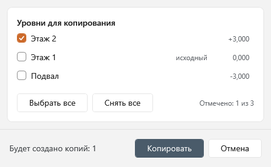
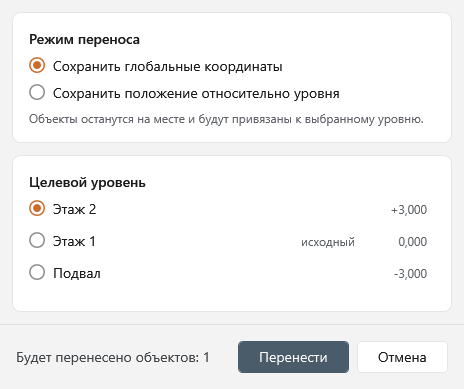

# Копирование и перенос по уровням для Renga

Плагин для [Renga](https://rengabim.com): копирует выделенные объекты на другие уровни и переносит их с одного уровня на другой. На панели «Действия» появляются две кнопки: «Копировать по этажам» и «Перенести на уровень».

Версия 0.4.

> Картинки в этом README - отрисовка окон плагина в тестовом приложении (с условными данными), а не снимки экрана из Renga: в самой Renga у окон есть заголовок и рамка, а названия уровней будут вашими.

## Возможности
- **Две кнопки** на панели «Действия» (в 3D-виде и в плане уровня): «Копировать по этажам» и «Перенести на уровень». Работают с тем, что выделено в модели.
- **Копирование на несколько уровней**: в окне отмечаются любые уровни, на каждом создаётся копия каждого выделенного объекта. Положение в плане (X, Y), поворот и высота относительно уровня остаются такими же, как у оригинала.
- **Перенос на один уровень** с двумя режимами:
  - **«Сохранить глобальные координаты»** (по умолчанию) - объект привязывается к выбранному уровню, но остаётся на тех же глобальных координатах, без вертикального смещения;
  - **«Сохранить положение относительно уровня»** - объект сдвигается вместе с уровнем, высота над уровнем сохраняется.

  Выбранный режим запоминается до перезапуска Renga.

  

  
- **Поддерживаемые типы объектов**: стены, ленточные фундаменты, балки, перекрытия, колонны, изолированные фундаменты, оборудование, механическое оборудование, сантехприборы, «Элементы», а с версии 0.3 - **лестницы, пандусы и крыши** (у крыши сохраняются уклоны, свесы и форма кромки).
- **Зависимые объекты копируются и переносятся вместе с хозяином** и появляются на тех же местах: окна, двери и отверстия стен (с сохранением точки вставки «слева/справа/по центру»), проёмы и отверстия перекрытий, отверстия колонн.
- **Уровень-источник** в списке помечен «исходный»; объекты, которые уже лежат на выбранном уровне, пропускаются.
- Итоговых окон нет: подробности (что создано, что пропущено и почему, сколько раз нажать Ctrl+Z) пишутся в журнал плагина.

## Что нового в 0.4
- Новый вид окон в стиле Windows 11: карточки, подвал со строкой состояния и кнопками, отметки уровней столбиком, оранжевые флажки и точки выбора. Строка под списком показывает, сколько уровней отмечено. Ход записи при большом числе копий («Создано N из M», «Перенесено N из M») виден в строке состояния.
- Новые значки кнопок на панели «Действия».
- Функциональность не менялась.

## Что нового в 0.3
- Перекрытия с проёмами и отверстиями и колонны с отверстиями копируются и переносятся.
- Лестницы, пандусы и крыши (с уклонами и свесами).
- Окна и двери с точкой вставки «слева» или «справа» больше не смещаются на полширины при копировании и переносе.
- Перенос в режиме «Сохранить глобальные координаты» стен, перекрытий и колонн с отверстиями исправлен: раньше новые отверстия мешали старым, стоящим на том же месте.
- Если при переносе не записался хотя бы один параметр или свойство, исходные объекты не удаляются.
- В итоге и в журнале - «объектами», «окон, дверей, проёмов и отверстий».

## Требования
- Windows.
- Renga с поддержкой плагинов .NET 8 (в манифесте указан API 2.49).

## Установка
1. Скачайте архив `CopyToLevels-0.4.zip` на странице [Releases](../../releases).
2. Закройте Renga.
3. Распакуйте архив и скопируйте папку `CopyToLevels` в `C:\Program Files\Renga Professional\Plugins\` (потребуются права администратора).
4. Запустите Renga: на панели «Действия» появятся кнопки «Копировать по этажам» и «Перенести на уровень».

Если кнопок нет, посмотрите журнал `%localappdata%\Renga Software\Renga Professional\AecApp.log`. Журнал самого плагина - `%APPDATA%\CopyToLevels\`.

## Как пользоваться
**Копирование**
1. Выделите в модели объекты (3D-вид или план уровня).
2. Нажмите «Копировать по этажам» на панели «Действия».
3. Отметьте нужные уровни. «Выбрать все» и «Снять все» отмечают весь список. Строка под списком показывает, сколько копий будет создано и сколько объектов пропущено.
4. Нажмите «Копировать».

**Перенос**
1. Выделите объекты.
2. Нажмите «Перенести на уровень».
3. Выберите режим переноса и один целевой уровень.
4. Нажмите «Перенести».

Результат можно отменить Ctrl+Z. Число нажатий зависит от того, что было создано (обычно от одного до трёх), оно записывается в журнал плагина.

## Известные ограничения
- Новый объект создаётся, а при переносе исходный удаляется, поэтому **у переносимых объектов меняются id**. Сторонние связи по id, спецификации, построенные по id, и привязки к ним не сохраняются.
- **Электрооборудование на стене** (щиты, светильники, розетки) при копировании молча не копируется: стена копируется без него. При переносе такая стена не переносится вовсе (иначе оборудование потерялось бы вместе с исходной стеной), причина записывается в журнал.
- **Балки, фундаменты и крыши с проёмами или отверстиями** пока не копируются и не переносятся: такие объекты пропускаются, причина - в журнале.
- **Проём перекрытия** не копируется (и перекрытие целиком пропускается), если у проёма есть марка, заполненные свойства, смещение по высоте или глубина, не равная толщине перекрытия. Отверстия повёрнутые, со смещениями, круглые и очень близкие друг к другу тоже не определяются: хозяин пропускается.
- **Ограждения лестниц** - отдельные объекты, не копируются (и не переносятся вместе с лестницей).
- Типы **арматура, пластина, линия, штриховка, сборка** пока не поддерживаются.
- Окно или дверь с точкой вставки «слева/справа» **в дуговой стене** проверено только расчётом: допуск самопроверки при переносе 0,5 мм, на очень узких дугах она может отказать (объект при этом не переносится, исходный цел).
- Копирование стены на уровень, где уже стоит такая же стена с отверстием на том же месте, не создаст отверстие: Renga не позволяет двум отверстиям пересекаться.
- Отменять результат нужно Ctrl+Z несколько раз (обычно 1-3): запись выполняется несколькими операциями, а не одной.
- Итоговых окон нет: подробности, число нажатий Ctrl+Z и причины пропусков - только в журнале `%APPDATA%\CopyToLevels\`.
- Одновременно работает только одна из двух команд.
- Плагин проверен автором на тестовых проектах; нестандартные случаи (повёрнутые или круглые отверстия, смещённые проёмы и т. п.) проверены не полностью и могут быть пропущены.

## Особенности API Renga и обходные решения
В API Renga нет операций «копировать на уровень» и «переместить на уровень» (в самой программе есть Ctrl+C/Ctrl+V), поэтому плагин **создаёт объекты заново и записывает параметры**, а при переносе после проверки удаляет исходный объект. Из-за этого пришлось применять много обходных решений - они подтверждены опытами на Renga 9.3 и перечислены здесь на случай, если вы пишете свои плагины или хотите сообщить об этом разработчикам Renga:
- **Целочисленные параметры** нельзя записать у только что созданного объекта (ошибка `0x80010105`): они пишутся отдельной операцией после применения.
- **Зависимый объект** (окно, дверь, отверстие, проём) нельзя создать в одной операции со своим хозяином: сначала применяется хозяин.
- **Проём перекрытия.** Запись контура и глубины в одной операции с созданием проёма роняет `Apply` (ошибка `0x80010105`, операция остаётся активной и модель перестаёт читаться до перезапуска Renga). Рабочий порядок: создать проём без контура, применить, затем задать контур отдельной операцией.
- **Положение отверстия** через API не читается: центр отверстия вычисляется по вершинам трёхмерной сетки хозяина (отдельные алгоритмы для стены, перекрытия и колонны).
- **Точка вставки окна и двери.** `Position` - всегда центр окна, а запись параметра вставки сдвигает тело окна на полширины. Поэтому окно создаётся в заранее смещённой точке.
- **Высота окон и дверей** считается от уровня и не следует за стеной (при сдвиге стены окна отвязываются), а отверстия и проёмы следуют за хозяином. Из-за этого перенос с сохранением глобальных координат выполняется в несколько шагов: хозяин с отверстиями создаётся выше, опускается сменой смещения, и только затем создаются окна и двери.
- **Новый объект поверх старого** конфликтует с чужими отверстиями («Cannot calculate placement within the host's bounding body»).
- **Перемещение объекта** через `SetPlacement` с другой высотой ничего не меняет, высота меняется только параметром «Смещение».
- **Электрооборудование на стене** входит в зависимые объекты хозяина, но не имеет уровня и в копии не создаётся.
- Арматурный стержень создать через API нельзя.

Из-за такого числа шагов отмена результата требует нескольких нажатий Ctrl+Z (число записывается в журнал). Всё это было бы не нужно при наличии в API готовых операций копирования и переноса на уровень.

## О разработке
Плагин разработан с помощью искусственного интеллекта (Claude, Anthropic) под руководством автора. Работа плагина проверялась автором в Renga на тестовых проектах, но программа поставляется «как есть», без гарантий: перед использованием на важных проектах проверьте результат и сохраните копию проекта (изменения отменяются Ctrl+Z).

## Лицензия
Все права защищены, см. [LICENSE](LICENSE). Исходный код не публикуется. Сторонние компоненты: сборки Renga SDK.
